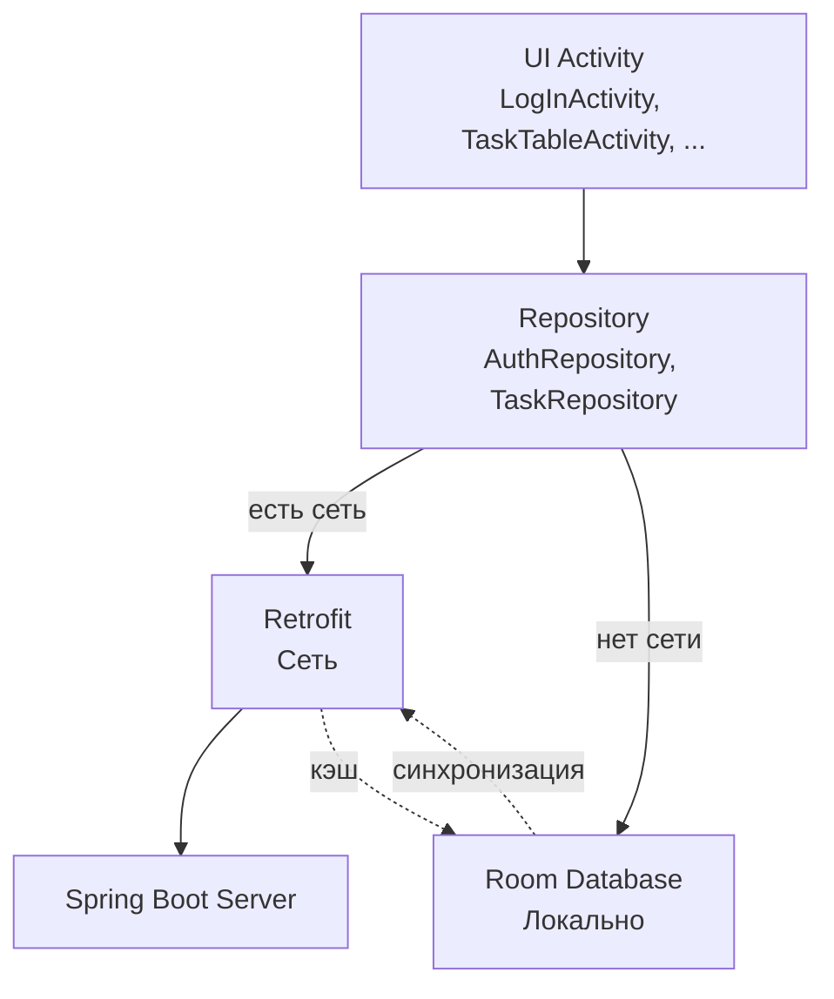

# Task Manager — Android Client

Мобильное приложение для управления задачами с поддержкой работы онлайн и offline.
Клиентская часть проекта, работающая в связке с сервером на Spring Boot.

---


##  Функционал

- Регистрация нового пользователя с валидацией
- Вход в аккаунт с запоминанием сессии
- Автоматический вход при повторном запуске
- Просмотр списка задач пользователя
- Создание, редактирование и удаление задач
- Выбор дедлайна через Material DatePicker
- **Offline-режим**: работа без интернета через локальную БД
- **Синхронизация** с сервером при появлении сети
- Выход из аккаунта с очисткой данных

---

##  Технологии

| Категория | Технологии |
|-----------|-----------|
| Язык | Kotlin |
| UI | XML, Material Components, ConstraintLayout |
| Сеть | Retrofit 2, OkHttp, Gson |
| Локальная БД | Room (SQLite) |
| Асинхронность | Coroutines, Flow |
| Архитектура | Repository, MVVM-элементы |
| DI | Lazy-инициализация |

---

## Архитектура

Приложение построено по паттерну **Repository** с двумя источниками данных:
**сервер** (Retrofit) и **локальная БД** (Room).

### Схема




**Логика работы:**

1. Если сеть доступна — данные берутся с сервера.
2. Серверные данные сохраняются в Room для offline-доступа.
3. Если сети нет — данные читаются из Room.
4. Изменения, сделанные offline, помечаются `isSynced = false`
   и отправляются на сервер при появлении сети.

---

## Структура проекта

### Android-клиент

```
app/src/main/java/com/example/myapplication/
│
├── api/
│   ├── ApiClient.kt              Retrofit-клиент
│   ├── AuthApi.kt                API для /api/auth/*
│   └── TaskApi.kt                API для /api/tasks/*
│
├── data/
│   └── NetworkUtils.kt           Проверка наличия интернета
│
├── dto/
│   ├── AuthResponseDto.kt        Ответ сервера на вход/регистрацию
│   ├── LoginRequestDto.kt        Запрос входа
│   ├── RegisterRequestDto.kt     Запрос регистрации
│   ├── TaskRequestDto.kt         Запрос создания/изменения задачи
│   └── TaskResponseDto.kt        Ответ с данными задачи
│
├── local/
│   ├── AppDatabase.kt            Room-база данных
│   ├── TaskEntity.kt             Локальная сущность задачи
│   ├── dao/
│   │   ├── TaskDao.kt            DAO для задач
│   │   └── UserDao.kt            DAO для пользователей
│   └── user/
│       └── UserEntity.kt         Локальная сущность пользователя
│
├── model/
│   ├── Task.kt                   Модель 
│   └── UserStorage.kt            Хранилище 
│
├── repository/
│   ├── AuthRepository.kt         Логика регистрации/входа
│   └── TaskRepository.kt         Логика CRUD задач
│
├── widget/
│   └── TaskAdapter.kt            RecyclerView-адаптер
│
├── AddTaskActivity.kt            Экран создания задачи
├── LogInActivity.kt              Экран входа
├── MainActivity.kt               Заставка с автологином
├── RegistrationActivity.kt       Экран регистрации
├── TaskDetailActivity.kt         Экран деталей задачи
└── TaskTableActivity.kt          Экран списка задач
```

### Ресурсы

```
app/src/main/res/
│
├── anim/
│   ├── fade_in.xml               Анимация появления
│   └── fade_out.xml              Анимация исчезновения
│
├── color/
│   └── box_stroke_color.xml      Состояния рамок полей
│
├── drawable/
│   ├── baseline_add_24.xml       Иконка «плюс»
│   ├── bg_cell_border.xml        Фон ячеек таблицы
│   ├── ic_launcher_background.xml
│   ├── ic_launcher_foreground.xml
│   ├── main_background.jpg       Фон приложения
│   └── opening_background.jpg    Фон заставки
│
├── layout/
│   ├── activity_add_task.xml     Создание задачи
│   ├── activity_main.xml         Заставка
│   ├── activity_registration.xml Регистрация
│   ├── activity_second_lay.xml   Вход
│   ├── activity_task_detail.xml  Детали задачи
│   ├── activity_task_table.xml   Список задач
│   ├── item_row_task.xml         Строка задачи
│   └── row_task_header.xml       Шапка таблицы
│
├── mipmap-mdpi/                  Иконки (mdpi)
├── mipmap-hdpi/                  Иконки (hdpi)
├── mipmap-xhdpi/                 Иконки (xhdpi)
├── mipmap-xxhdpi/                Иконки (xxhdpi)
├── mipmap-xxxhdpi/               Иконки (xxxhdpi)
│
├── values/
│   ├── colors.xml                Цвета приложения
│   ├── strings.xml               Строки
│   └── themes.xml                Темы
│
└── xml/
    ├── backup_rules.xml
    └── data_extraction_rules.xml
```

### Gradle-файлы

```
MyApplication2/
│
├── app/
│   ├── build.gradle.kts          Модуль приложения
│   ├── proguard-rules.pro        Правила R8/ProGuard
│   └── src/
│
├── gradle/
│   ├── libs.versions.toml        Версии библиотек
│   └── wrapper/
│       ├── gradle-wrapper.jar
│       └── gradle-wrapper.properties
│
├── build.gradle.kts              Корневой Gradle
├── settings.gradle.kts           Настройки проекта
├── gradle.properties             Свойства Gradle
├── gradlew                       Gradle Wrapper (Linux/macOS)
├── gradlew.bat                   Gradle Wrapper (Windows)
└── local.properties              Путь к Android SDK
```

##  Установка и запуск

### Требования

| Компонент | Версия |
|-----------|--------|
| JDK | 17+ |
| Android Studio | Rabbit 1 (2023.3.1) или новее |
| Android SDK | API 34+ |
| Gradle | 8.7+ (поставляется с Android Studio) |
| Запущенный сервер | Task Manager Server на `localhost:8080` |

### Шаг 1: Клонирование

```bash
git clone <ссылка-на-репозиторий>
cd TaskManagerAndroid
Или распакуйте ZIP-архив.

Шаг 2: Открытие в Android Studio
Запустите Android Studio.

File → Open → выберите папку с проектом.

Дождитесь синхронизации Gradle.

Шаг 3: Запуск сервера
Перед запуском клиента запустите серверную часть.
Инструкция — в README серверного проекта.

Шаг 4: Настройка подключения
Есть два способа подключения к серверу:

Способ A: Через USB (рекомендуется для отладки)
Подключите телефон по USB.

Включите Отладку по USB в настройках разработчика.

В терминале выполните:

bash
adb reverse tcp:8080 tcp:8080
Убедитесь, что туннель создан:

bash
adb reverse --list
# Ожидается: (reverse) tcp:8080 tcp:8080
В приложении BASE_URL в ApiClient.kt должен быть:

kotlin
private const val BASE_URL = "http://localhost:8080/"
Способ B: Через Wi-Fi
Убедитесь, что телефон и ПК в одной Wi-Fi сети.

Узнайте IP компьютера:

bash
ipconfig
# Найдите IPv4-адрес, например 192.168.1.10
Разрешите порт 8080 в брандмауэре Windows.

В ApiClient.kt укажите:

kotlin
private const val BASE_URL = "http://192.168.1.10:8080/"